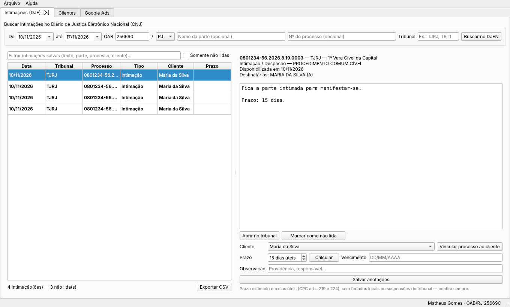
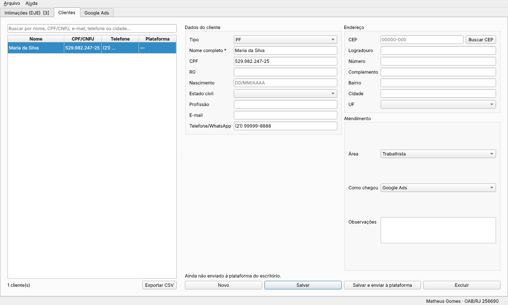
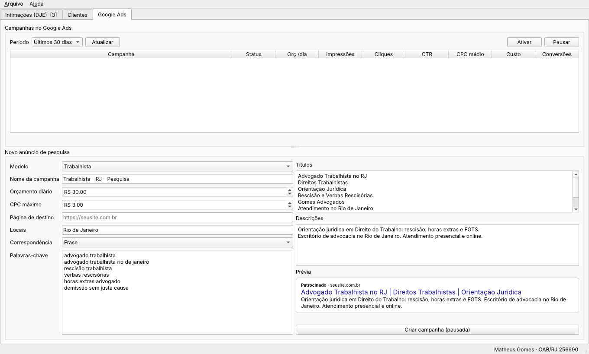

# Sistema Integrado — Gomes Advogados

Aplicativo desktop (Windows, macOS e Linux) que reúne em uma única janela:

1. **Intimações (DJE)** — busca automática no **DJEN** (Diário de Justiça Eletrônico Nacional, CNJ) pela OAB, parte, processo ou tribunal; marca lidas/não lidas, vincula ao cliente, calcula prazo em dias úteis e exporta CSV.
2. **Clientes** — cadastro completo (PF/PJ) com validação de CPF/CNPJ, preenchimento por CEP (ViaCEP) e envio à plataforma de gestão do escritório via API.
3. **Google Ads** — cria campanhas de pesquisa (orçamento, palavras-chave, anúncio responsivo, região, idioma) e acompanha impressões, cliques, custo e conversões. Modelos prontos por área e **alerta de termos vedados pelo Provimento OAB 205/2021**.

| Intimações | Clientes | Google Ads |
|---|---|---|
|  |  |  |

## Instalação (Windows)

1. Instale o [Python 3.11+](https://www.python.org/downloads/) marcando **“Add Python to PATH”**.
2. Baixe este repositório e dê dois cliques em **`iniciar.bat`**. Na primeira vez ele instala as dependências (alguns minutos).
3. Abra **Arquivo › Configurações** e confira os dados do escritório.

Para gerar um `.exe` que roda em qualquer computador do escritório sem Python: `gerar_executavel.bat`.

macOS/Linux:
```bash
python3 -m venv .venv && source .venv/bin/activate
pip install -r requirements.txt
python -m escritorio_gomes
```

Os dados ficam **somente no computador**, em `~/.escritorio_gomes/` (`escritorio.db` e `config.json` com as credenciais). Faça backup dessa pasta.

## 1. Intimações no DJE

Usa a API pública do CNJ (`comunicaapi.pje.jus.br`), que concentra as comunicações de todos os tribunais que publicam no DJEN — não precisa de login.

- Ao abrir o sistema (e a cada 2 horas com ele aberto) busca as intimações dos últimos *N* dias da OAB configurada e avisa quando há novas.
- Outras OABs do escritório podem ser monitoradas em Configurações › DJE (`[{"numero": "123456", "uf": "RJ"}]`).
- Intimações são associadas automaticamente ao cliente quando o nome do destinatário bate com o cadastro, ou quando o processo já foi vinculado (botão **Vincular processo ao cliente**).
- O cálculo de prazo é uma **estimativa** em dias úteis (arts. 219 e 224 do CPC) e não considera feriados locais nem suspensões do tribunal — sempre confira.

## 2. Clientes e plataforma do escritório

O cadastro é salvo localmente e pode ser enviado à plataforma de gestão (botão **Salvar e enviar à plataforma**) por um conector REST genérico. Em Configurações › Plataforma informe:

| Campo | Exemplo |
|---|---|
| URL base da API | `https://api.suaplataforma.com.br/v1` |
| Endpoint de clientes | `/clientes` |
| Cabeçalho / prefixo do token | `Authorization` / `Bearer ` |
| Token de API | gerado no painel da plataforma |
| Campo do ID na resposta | `id` (ou `data.id`) |
| Mapeamento de campos | `{"nome": "name", "cpf_cnpj": "document", "telefone": "phone"}` |

Clientes novos são enviados com `POST {endpoint}`; os já enviados são atualizados com `PUT {endpoint}/{id}`.
Campos locais: `tipo, nome, cpf_cnpj, rg, data_nascimento, estado_civil, profissao, email, telefone, cep, logradouro, numero, complemento, bairro, cidade, uf, area, origem, observacoes`. Mapear um campo para `""` deixa de enviá-lo.

## 3. Google Ads

Credenciais necessárias (Configurações › Google Ads):

1. **Developer token** — na conta de administrador (MCC): *Ferramentas › Centro de API*. Solicite acesso “Básico” para operar em contas reais.
2. **Client ID / Client Secret** — no [Google Cloud Console](https://console.cloud.google.com/): crie um projeto, ative a *Google Ads API* e crie credenciais OAuth do tipo **App para computador**.
3. **Refresh token** — gere com o script oficial `generate_user_credentials.py` da biblioteca `google-ads` (escopo `https://www.googleapis.com/auth/adwords`).
4. **ID da conta** (xxx-xxx-xxxx) e, se a conta estiver sob uma MCC, o **ID da MCC**.

Campanhas são criadas **pausadas** (pesquisa Google, CPC manual, português, locais informados). Revise no Google Ads ou ative pelo próprio sistema.

> Publicidade da advocacia: o sistema avisa sobre termos como “grátis”, “desconto”, “resultado garantido”, “o melhor”, vedados pelo Provimento OAB 205/2021. A responsabilidade final pelo conteúdo é do advogado.

## Desenvolvimento

```bash
pip install -r requirements.txt pytest
python -m pytest
```

Estrutura:

```
escritorio_gomes/
  config.py        configurações (~/.escritorio_gomes/config.json)
  db.py            banco SQLite
  clientes.py      cadastro, validação CPF/CNPJ, CEP
  plataforma.py    conector REST da plataforma do escritório
  dje.py           cliente da API do DJEN, persistência, prazos
  google_ads.py    campanhas e métricas do Google Ads
  gui/             interface (PySide6/Qt)
tests/
```
