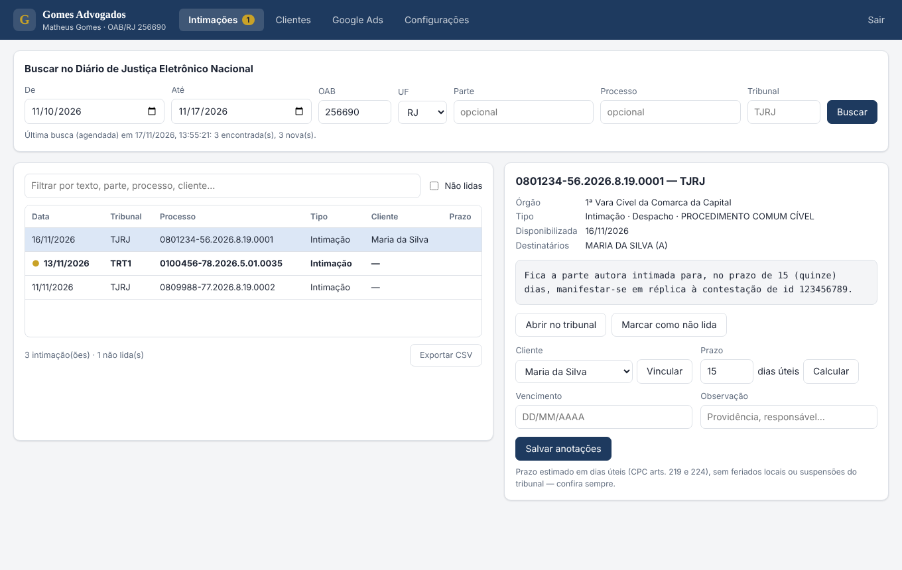
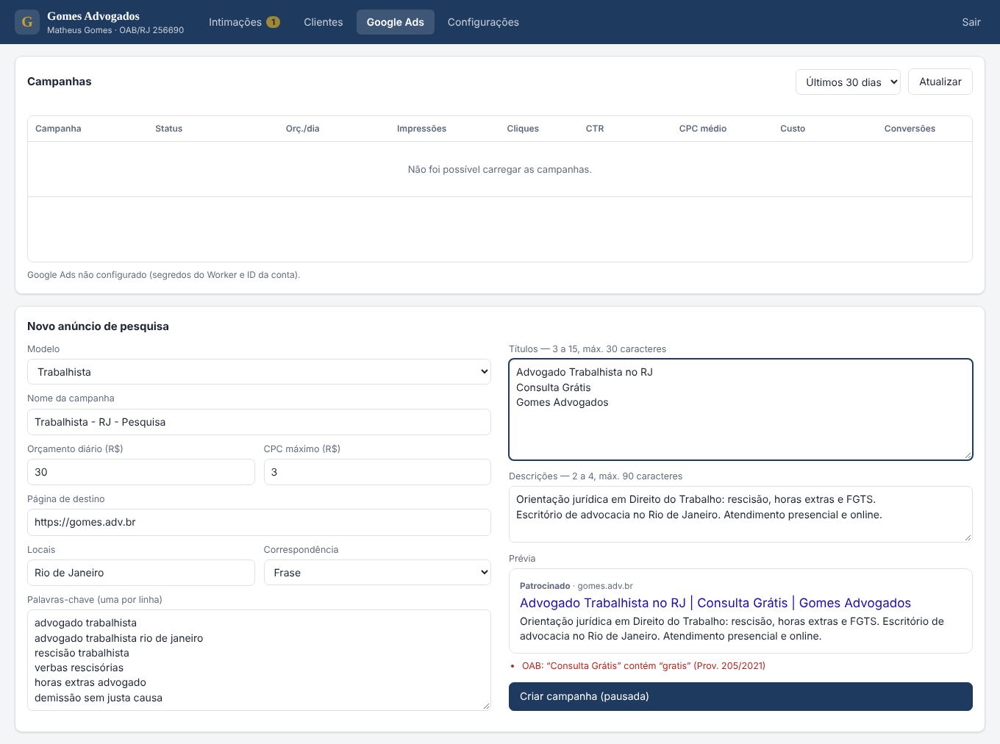
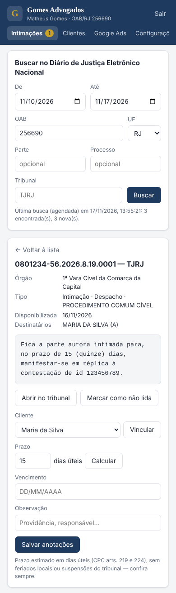

# Sistema do escritório — versão web (Cloudflare)

Mesmo sistema do app desktop, como site protegido por senha, rodando no **Cloudflare Workers** com banco **D1**:

- **Intimações (DJE):** busca no DJEN (CNJ) — manual e **automática em dias úteis às 8h, 12h e 17h** (cron do Cloudflare), mesmo com o computador desligado.
- **Clientes:** cadastro com validação de CPF/CNPJ, CEP automático e envio à plataforma do escritório.
- **Google Ads:** cria campanhas de pesquisa (pausadas) e mostra métricas, com alerta do Provimento OAB 205/2021.
- Funciona no computador e no **celular**.

| Intimações | Google Ads | Celular |
|---|---|---|
|  |  |  |

> **Importante — DJEN só aceita acessos do Brasil.** Buscas feitas pelo site (você acessando do Brasil) saem por um datacenter brasileiro do Cloudflare e funcionam. A busca agendada (cron) pode rodar fora do país e ser recusada; por isso, ao abrir o site, o sistema busca sozinho se não houve busca bem-sucedida nas últimas 3 horas. O resultado de cada busca aparece em “Última busca”.

## Publicar pela primeira vez

Pré-requisitos: conta gratuita no [Cloudflare](https://dash.cloudflare.com/sign-up) e [Node.js 20+](https://nodejs.org).

```bash
cd web
npm install
npx wrangler login                              # abre o navegador para autorizar
npx wrangler d1 create escritorio-gomes         # copie o database_id exibido
```

Cole o `database_id` em `wrangler.toml`, depois:

```bash
npx wrangler secret put APP_PASSWORD            # senha de acesso ao sistema
npx wrangler secret put SESSION_SECRET          # texto aleatório com 32+ caracteres
npm run deploy                                  # cria as tabelas e publica
```

O endereço aparece no final (ex.: `https://escritorio-gomes.<sua-conta>.workers.dev`).
Para usar um domínio próprio (ex.: `sistema.gomesadvogados.com.br`): painel do Cloudflare › Workers › escritorio-gomes › *Settings › Domains & Routes*.

### Segurança recomendada

O site já exige senha (cookie de sessão assinado, bloqueio após 10 tentativas erradas em 15 min, proteção CSRF). Para uma camada extra — **login por e-mail com código**, gratuito até 50 usuários — ative o **Cloudflare Access** (Zero Trust › Access › Applications › *Self-hosted*) para o domínio do sistema, liberando apenas os e-mails do escritório.

## Google Ads

Cadastre os segredos (as mesmas credenciais descritas no README principal):

```bash
npx wrangler secret put GOOGLE_ADS_DEVELOPER_TOKEN
npx wrangler secret put GOOGLE_ADS_CLIENT_ID
npx wrangler secret put GOOGLE_ADS_CLIENT_SECRET
npx wrangler secret put GOOGLE_ADS_REFRESH_TOKEN
```

e informe o **ID da conta** em *Configurações* no próprio site. A versão da API fica em `wrangler.toml` (`GOOGLE_ADS_API_VERSION`); o Google desativa versões após cerca de um ano — atualize quando necessário.

## Plataforma do escritório

`npx wrangler secret put PLATAFORMA_TOKEN` e preencha URL, endpoint e mapeamento de campos em *Configurações*.

## Deploy automático pelo GitHub

O workflow `.github/workflows/deploy-web.yml` publica a cada alteração em `web/` na branch `main` (ou manualmente em *Actions › Deploy site › Run workflow*). Cadastre em *Settings › Secrets and variables › Actions*:

- `CLOUDFLARE_API_TOKEN` — criado em dash.cloudflare.com › *My Profile › API Tokens* (modelo “Edit Cloudflare Workers” + permissão D1 Edit)
- `CLOUDFLARE_ACCOUNT_ID` — no painel, coluna da direita da página da conta

## Desenvolvimento local

```bash
cp .dev.vars.example .dev.vars    # defina APP_PASSWORD e SESSION_SECRET
npm run db:local
npm run dev                       # http://localhost:8787
npm test
```

Estrutura: `src/` (Worker: `index.js` rotas e cron, `dje.js`, `clientes.js`, `ads.js`, `plataforma.js`, `auth.js`), `public/` (interface), `migrations/` (banco D1).
